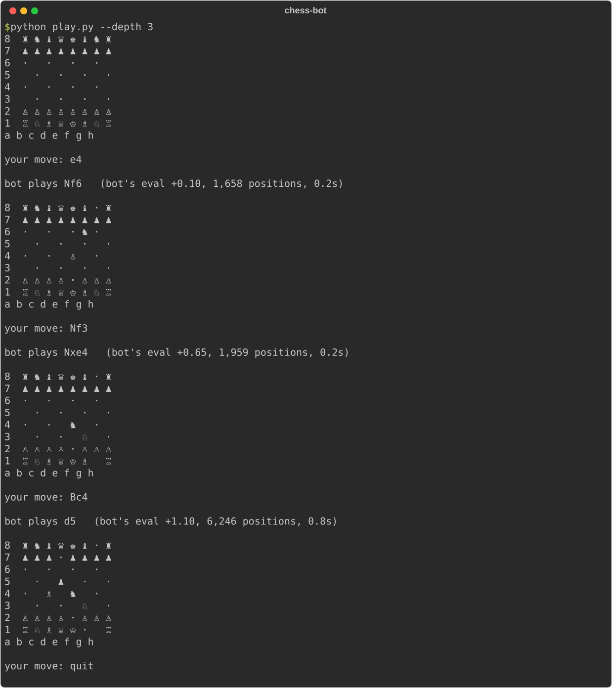
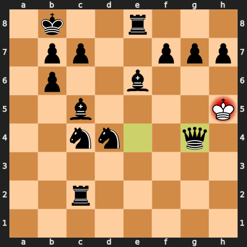
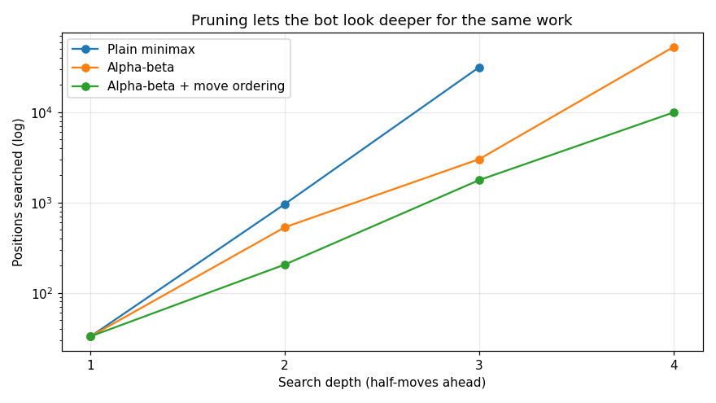
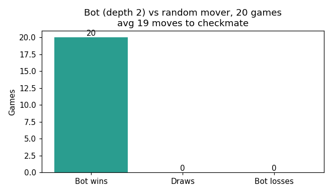

# Chess Bot

**Quick summary:** A chess engine you can play against in your terminal. It's written in Python with minimax search, alpha-beta pruning, move ordering, and quiescence search. It beat a random-move player in 20 of 20 games.



## Description
`python-chess` handles the rules (legal moves, check, castling). Everything that makes the bot *play* is mine, in `engine.py` (~150 lines):

| Piece | What it does |
|---|---|
| **Evaluation** | Counts material (pawn = 100, knight = 320, ... queen = 900) plus a *piece-square table* bonus. Knights prefer the center, the king prefers safety early on |
| **Negamax search** | Tries every move, then every reply, and so on N half-moves deep, assuming the opponent always picks their best answer |
| **Alpha-beta pruning** | Stops exploring a line as soon as it's proven worse than one already found. Same answer, a fraction of the work |
| **Move ordering (MVV-LVA)** | Looks at "big piece captured by small piece" moves first, so pruning kicks in sooner |
| **Quiescence search** | At the depth limit, keeps following captures so the bot never stops in the middle of a trade (the "horizon effect") |

Final position of one bot win against the random player (checkmate):



## Tools Used
- **Python**, **python-chess** (rules, board rendering)
- **Matplotlib** for benchmarks
- Tests: mate-in-one, free-queen capture, and "pruning returns the same score as full search"

## Scope
Terminal play against a fixed-depth engine. Opening books, endgame tablebases, and UCI/GUI support are future work.

## Objective
Learn how game-playing AI searches huge decision trees efficiently. Adversarial thinking ("assume the opponent plays their best move") is also the mindset behind threat modeling in security.

## Result
**Search efficiency** (Italian Game position, positions searched):

| Depth | Plain minimax | Alpha-beta | + Move ordering |
|---|---|---|---|
| 2 | 963 | 533 | **206** |
| 3 | 31,505 | 3,019 | **1,772** (≈18× less) |
| 4 | *(too slow)* | 52,728 | **9,934** |



**Strength check:** 20 games at depth 2 against a random mover: **20 wins, 0 draws, 0 losses**, with checkmate in 19 moves on average.



## What I Learned
- **Exponential growth is brutal:** about 35 legal moves per position means each extra ply multiplies the work about 35×. Pruning is the only reason deeper search is possible.
- Alpha-beta **never changes the result**, only the cost (my test checks this).
- **Move ordering** matters as much as the pruning itself, because pruning only works if good moves get searched first.
- The **horizon effect:** without quiescence search the bot "wins" a pawn and misses that its queen gets taken one move later.
- Negamax simplifies the code: my best score = −(opponent's best score).

## Run It
```bash
pip install -r requirements.txt
python play.py              # you're white, bot searches 3 ply
python play.py --black --depth 4
python test_engine.py
python bench.py             # regenerate charts (~1 min)
```
Enter moves like `e4`, `Nf3`, `O-O`, or `e2e4`.
